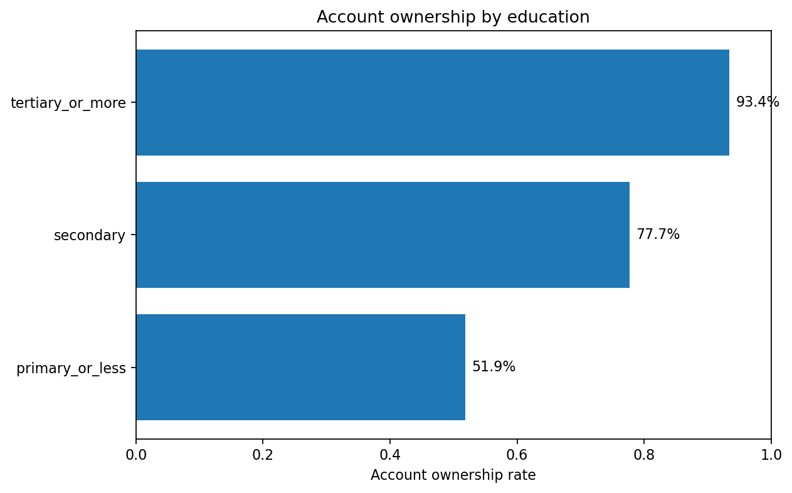
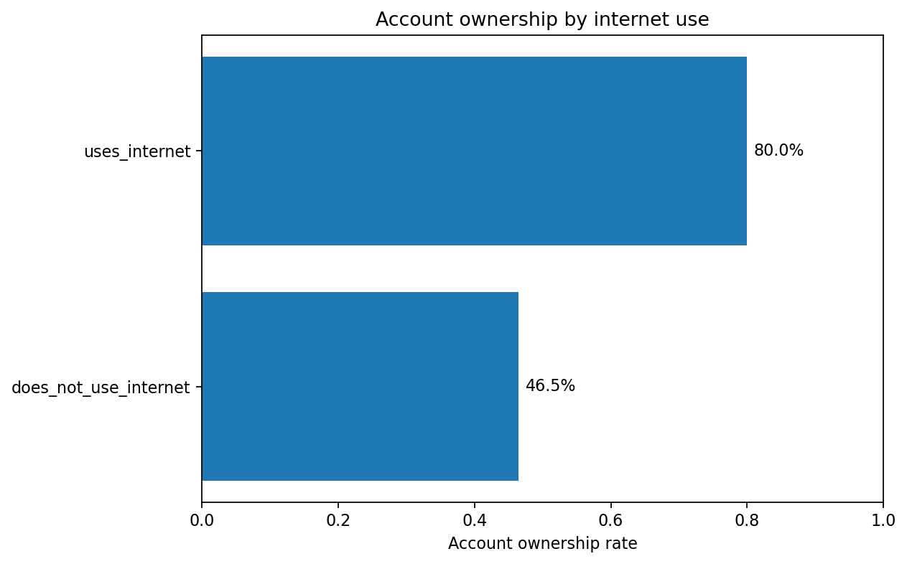
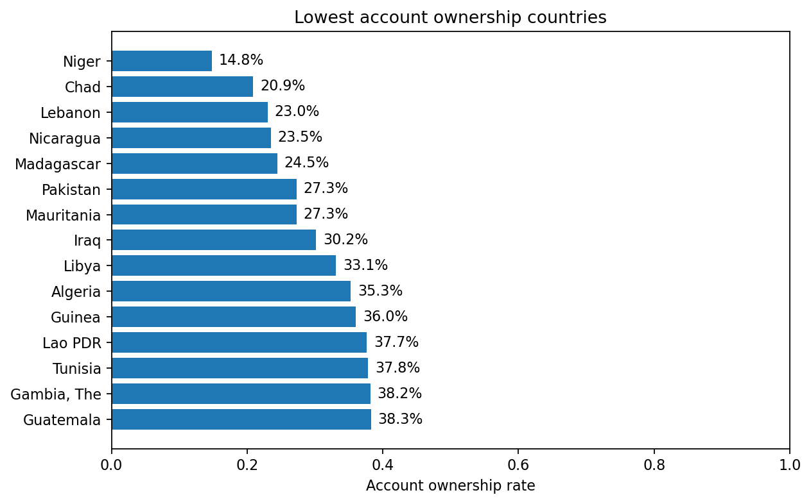
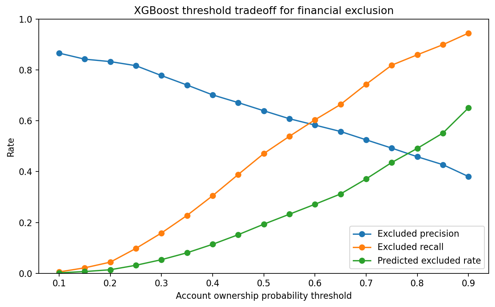
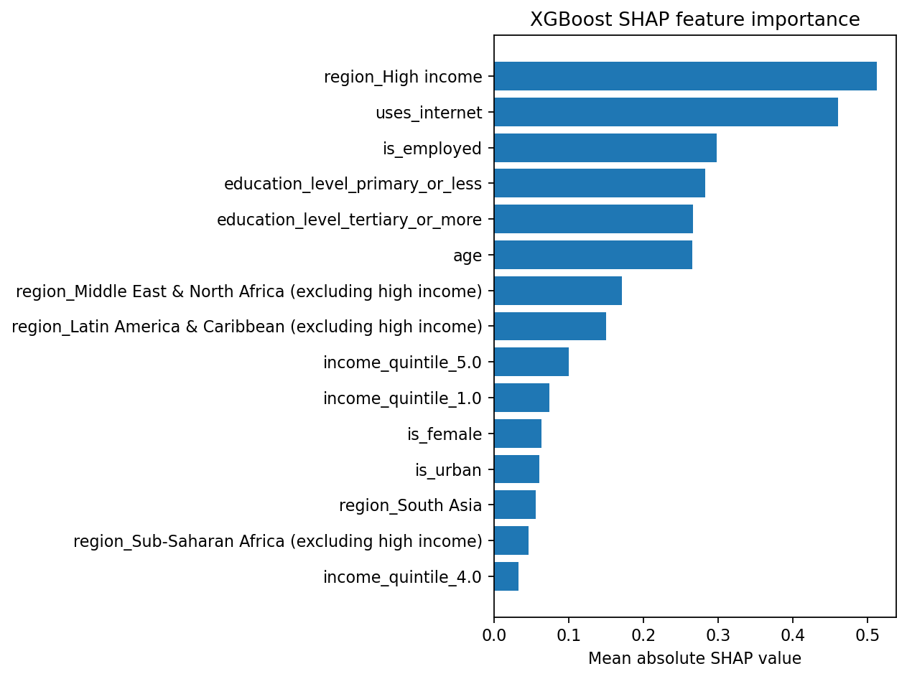
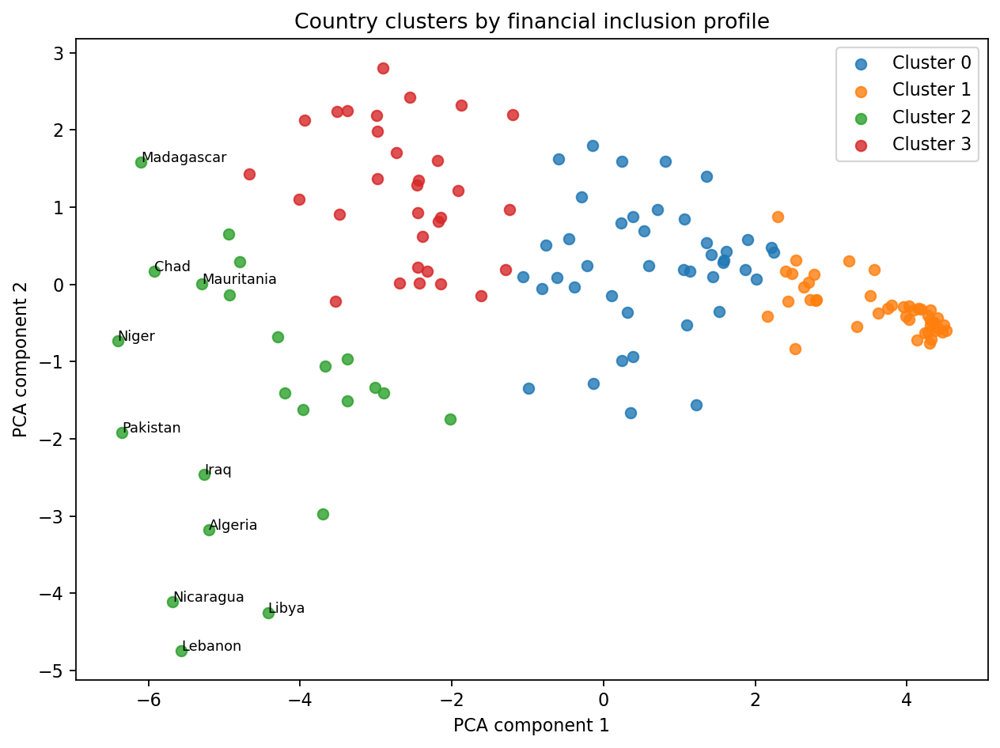

# Financial Inclusion ML

A solo-friendly applied data science project using the World Bank Global Findex 2025 microdata to analyze financial inclusion, predict account ownership, explain model drivers, cluster countries, and recommend policy interventions.

## Project question

> Which groups are financially excluded, what predicts inclusion, and which policy intervention would likely help most?

## Why this project matters

Financial inclusion is about whether people can access and use useful financial services such as accounts, payments, savings, credit, and tools for managing financial risk.

Account ownership matters because it can connect people to:

- safer storage of money
- digital payments
- formal saving
- formal borrowing
- wage, transfer, and remittance channels
- financial resilience during shocks

This project connects financial inclusion with machine learning, explainability, and policy analysis.

## What this repo demonstrates

This repository shows that I can:

- work with real international development survey data
- document data sources and dataset decisions
- clean and validate microdata
- perform weighted exploratory analysis
- build classification models
- compare baseline and advanced models
- analyze threshold tradeoffs for policy targeting
- use SHAP for explainability
- cluster countries by inclusion profile
- translate analysis into a practical policy recommendation

## Dataset

Main dataset:

- World Bank Global Findex 2025 microdata
- 144,090 adult respondents
- 140 economies
- account ownership as the main target

The raw microdata is not committed to this repository. The repo includes scripts that reproduce the processed data from the downloaded raw files.

Expected raw file location:

```text
data/raw/global_findex_2025_microdata/findex_microdata_2025_labelled_update112425.csv
```

## Target

The supervised learning target is account ownership:

```text
target = 1: respondent owns an account
target = 0: respondent does not own an account
```

Account ownership is used as the core measure of basic financial inclusion.

## Methods

The project includes:

1. data acquisition documentation
2. microdata inspection
3. core data cleaning
4. weighted EDA
5. model table construction
6. logistic regression baseline
7. XGBoost model
8. model comparison
9. threshold analysis
10. SHAP explainability
11. country clustering
12. policy recommendation

## Key EDA findings

Weighted account ownership is 71.0%.

Account ownership is lower among:

| Group comparison | Lower-inclusion group | Rate | Higher-inclusion group | Rate |
|---|---|---:|---|---:|
| Gender | women | 68.1% | men | 74.1% |
| Education | primary education or less | 51.9% | tertiary education or more | 93.4% |
| Income | poorest quintile | 61.1% | richest quintile | 80.6% |
| Internet use | does not use internet | 46.5% | uses internet | 80.0% |
| Urbanicity | rural | 66.3% | urban | 76.6% |

The strongest observed gaps are education and internet use.

## Selected figures

### Account ownership by education



### Account ownership by internet use



### Lowest account ownership countries



## Model results

Two models were trained:

- logistic regression baseline
- XGBoost advanced model

| Metric | Logistic regression | XGBoost |
|---|---:|---:|
| Test AUC | 0.822 | 0.831 |
| Accuracy | 73.6% | 79.2% |
| F1 | 0.802 | 0.865 |
| Excluded precision | 49.8% | 64.0% |
| Excluded recall | 77.7% | 47.1% |

XGBoost performs better overall, but logistic regression has higher excluded recall at the default 0.5 threshold.

This matters because the project is about financial exclusion, not only overall model performance.

## Threshold analysis

For policy targeting, the default threshold is not always the right choice.

XGBoost threshold analysis shows three useful options:

| Policy goal | Threshold | Excluded precision | Excluded recall |
|---|---:|---:|---:|
| Reach | 0.75 | 49.3% | 81.9% |
| Efficiency | 0.40 | 70.2% | 30.5% |
| Balanced | 0.70 | 52.5% | 74.4% |

Interpretation:

- use a reach-oriented threshold to find more excluded people
- use an efficiency-oriented threshold to avoid wasting limited resources
- use a balanced threshold when both goals matter



## SHAP explainability

The strongest XGBoost prediction drivers are:

1. region context
2. internet use
3. employment status
4. education level
5. age
6. income quintile
7. gender
8. urbanicity



These are predictive associations, not causal effects.

## Country clustering

Countries were clustered by financial inclusion profiles derived from the microdata.

The analysis found four broad profiles:

| Cluster profile | Average account rate | Interpretation |
|---|---:|---|
| Very low inclusion | 35.2% | broad financial exclusion with large gender gaps |
| Low/mid inclusion with large inequality gaps | 54.0% | inclusion exists but is uneven across groups |
| Mid/high inclusion | 76.1% | stronger inclusion but remaining subgroup gaps |
| Very high inclusion | 95.5% | near-universal account ownership and small gaps |



## Policy recommendation

The final recommendation is:

> Prioritize digital access plus assisted account onboarding for adults with low education, low income, no internet use, and people living in low-inclusion countries.

This means helping excluded adults both access digital channels and complete the practical steps needed to open and use an account.

Priority groups:

- adults with primary education or less
- adults in the poorest income quintiles
- adults who do not use the internet
- rural residents
- women in countries with large gender gaps
- very low inclusion country clusters

## Limitations

This project is descriptive and predictive, not causal.

Important limitations:

- observational survey data cannot prove policy impact
- country-level clustering depends on selected features
- model predictions depend on survey variables and missingness patterns
- survey weights are used in EDA but not yet in model fitting
- account ownership is only one measure of financial inclusion
- the project does not estimate treatment effects

## Repository structure

```text
data/
  raw/                 # ignored raw downloads
  interim/             # ignored cleaned intermediate data
  processed/           # ignored model-ready data

figures/               # selected committed visuals

models/                # ignored trained model files

notebooks/
  01_microdata_inspection.ipynb
  02_first_eda.ipynb

references/
  data_sources.md
  data_inventory.csv
  dataset_decision.md
  initial_variable_map.csv
  microdata_column_notes.md

reports/
  first_eda_summary.md
  model_table_quality.md
  baseline_model_results.md
  xgboost_model_results.md
  model_comparison.md
  threshold_analysis.md
  shap_summary.md
  country_clusters.md
  policy_recommendation.md
  final_project_summary.md

src/
  clean_microdata.py
  build_model_table.py
  train_baseline_model.py
  train_xgboost_model.py
  compare_models.py
  analyze_thresholds.py
  explain_xgboost_shap.py
  build_country_profiles.py
  cluster_countries.py
```

## Reproduce the project

Create the environment and install dependencies:

```bash
pip install -r requirements.txt
```

Place the raw Global Findex 2025 microdata CSV at:

```text
data/raw/global_findex_2025_microdata/findex_microdata_2025_labelled_update112425.csv
```

Run the project pipeline:

```bash
python -m src.clean_microdata
python -m src.build_model_table
python -m src.make_first_eda_report
python -m src.make_first_eda_figures
python -m src.train_baseline_model
python -m src.train_xgboost_model
python -m src.compare_models
python -m src.analyze_thresholds
python -m src.explain_xgboost_shap
python -m src.build_country_profiles
python -m src.cluster_countries
python -m src.make_policy_recommendation
```

## Main reports

Start here:

- [`reports/final_project_summary.md`](reports/final_project_summary.md)
- [`reports/policy_recommendation.md`](reports/policy_recommendation.md)
- [`reports/model_comparison.md`](reports/model_comparison.md)
- [`reports/threshold_analysis.md`](reports/threshold_analysis.md)
- [`reports/shap_summary.md`](reports/shap_summary.md)
- [`reports/country_clusters.md`](reports/country_clusters.md)

## Final takeaway

Financial exclusion is concentrated among adults with lower education, lower income, no internet use, rural residence, and people living in low-inclusion countries.

The best portfolio-level recommendation is a targeted digital access and assisted onboarding strategy, adapted by country cluster and evaluated with explicit threshold tradeoffs.
